<div align="center">

# Neural Space Cap — Hardware

**A 3D-printed EEG cap generated from a LiDAR scan of one specific head.**

Three tape measurements, or a phone scan, in. Electrode positions, a marking
template, and print-ready STLs out.

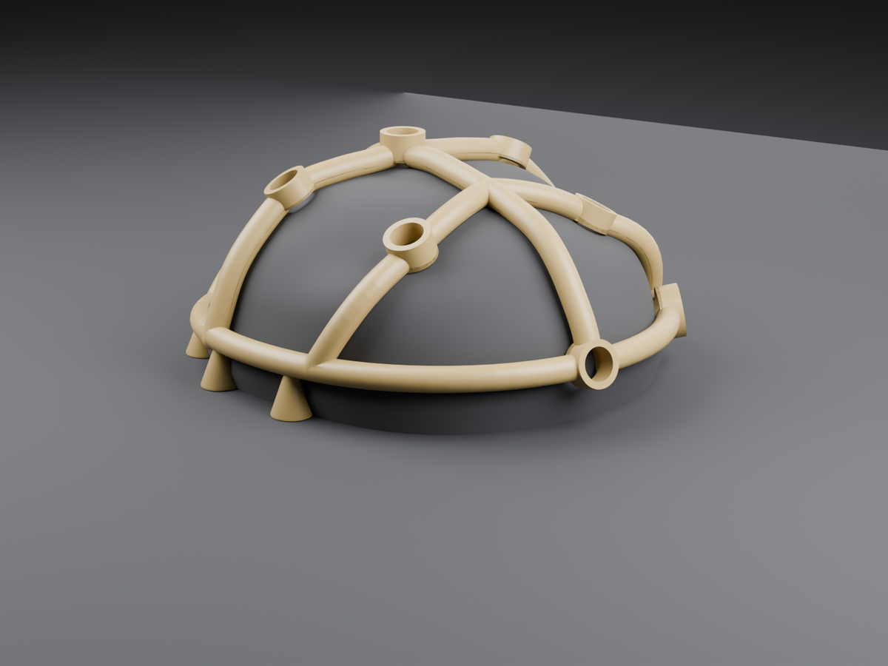

Purdue VIP · AAMED · companion to
**[Neural-Space-Cap-Software](https://github.com/SoumilBhandari/Neural-Space-Cap-Software)**
(firmware and signal processing)

</div>

---

## The problem

Two failures cost this team real data, and both are about geometry rather than electronics.

**An electrode that moves is an electrode you cannot compare.** A sensor taped
to a temple with a bandaid sits somewhere slightly different every session, and
that movement is indistinguishable from the subject's physiology changing.

**Electrode contact was the largest single source of noise.** The instinctive
fix, cinching the cap tighter, makes it *worse*: it mats the hair under the cup
instead of parting it.

So the cap has to put every electrode on a defined anatomical site, return it to
the same site next week, and press each one with the same force regardless of how
tightly it is worn.

---

## What it produces

<table>
<tr>
<td width="50%">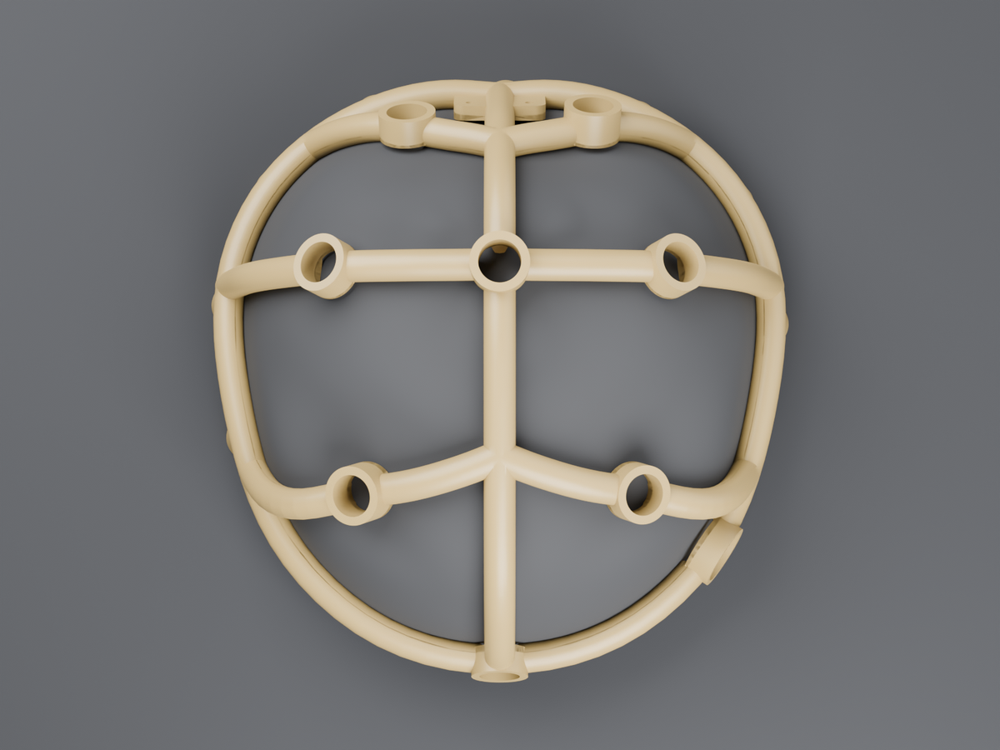</td>
<td width="50%">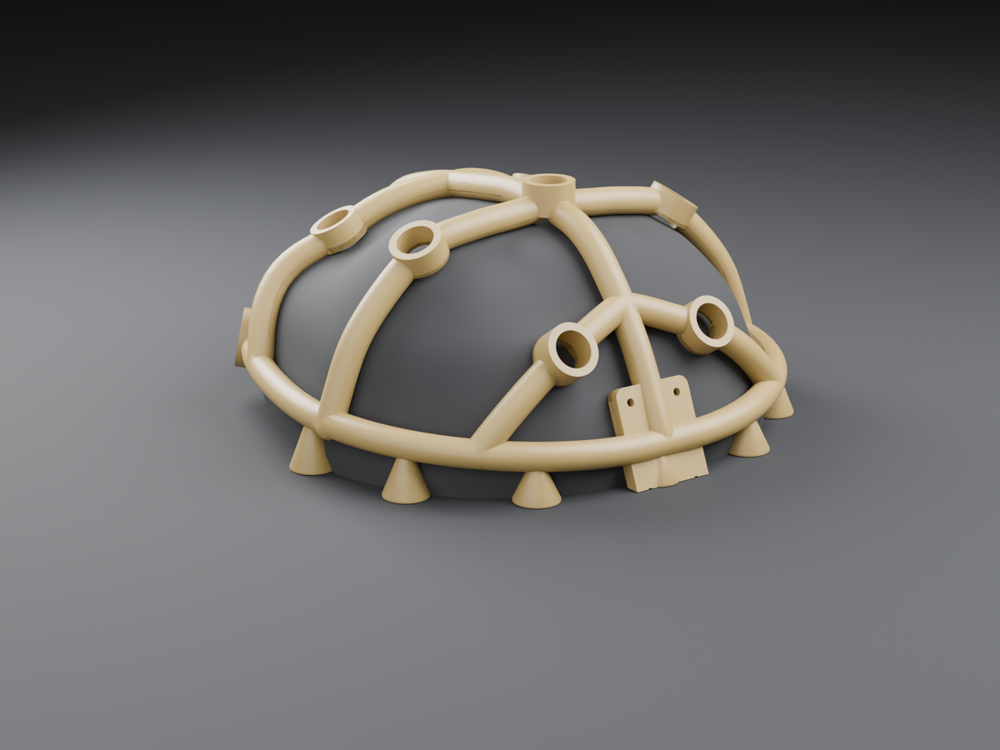</td>
</tr>
<tr>
<td colspan="2" align="center"><em>A closed ring braced by four arches, carrying eight electrode sockets, a temple seat for the heart-rate sensor, and a pod mount at the back</em></td>
</tr>
</table>

| | |
|---|---|
| **Montage** | Fpz, F3, F4, C3, Cz, C4, P3, P4 — International 10-20 |
| **Phase one** | F4, Cz, P3 stand 2.5 mm proud so you can find them by hand |
| **Fit** | Built on the scanned surface, not a scaled generic head |
| **Output** | Watertight single-shell STLs with sacrificial print feet |
| **Also** | 1:1 marking template, montage map, 3D positions CSV |

---

## Quick start

```bash
# From tape measurements: template, montage map, positions, printed parts
make fit SUBJECT="subject A" CIRC=575 NI=350 PA=340
make parts

# From a LiDAR scan: a frame fitted to that specific head
make scan SCAN=scan/head.obj SCAN_CIRC=660

# Four sizes to print and try
make scan-sizes

# A 5-minute coupon that tells you whether the electrode presses in
make coupon
```

Needs Python with NumPy/SciPy, OpenSCAD, and Blender for renders.

---

## How a scan becomes a cap

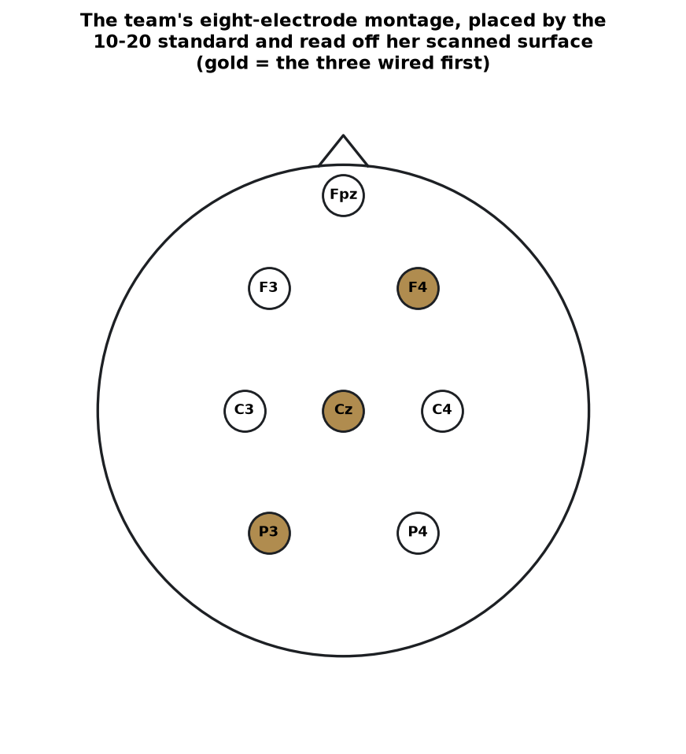

**1. Isolate the head.** A phone scan is a 5.4 × 4.7 m room. The head is the
narrow cluster at the top.

**2. Weld it.** Scanners duplicate a vertex per texture island, so the mesh is
topologically shattered. Before welding, the largest connected piece of this
head was about **1%** of it.

**3. Find the face.** A bare scan has no landmarks, and the whole montage
depends on knowing which way is forward. Detected from **skin colour** in the
scan's own photograph.

**4. Repair dropout.** Mirror the intact side across and keep the larger of
each pair, because a dropout is a collapse *inward*.

**5. Resample to a height field.** Distance from the head centre out to the
hair, in every direction. This is what the CAD is built on, and it is what
makes the cap hers.

**6. Place the montage.** 10-20 defines sites as percentages along arcs between
bony landmarks. Direction comes from the standard; position is read off her
surface along that direction.

<br clear="right">

| 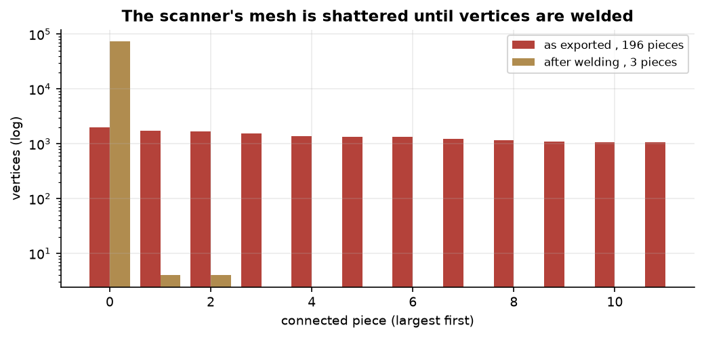 | 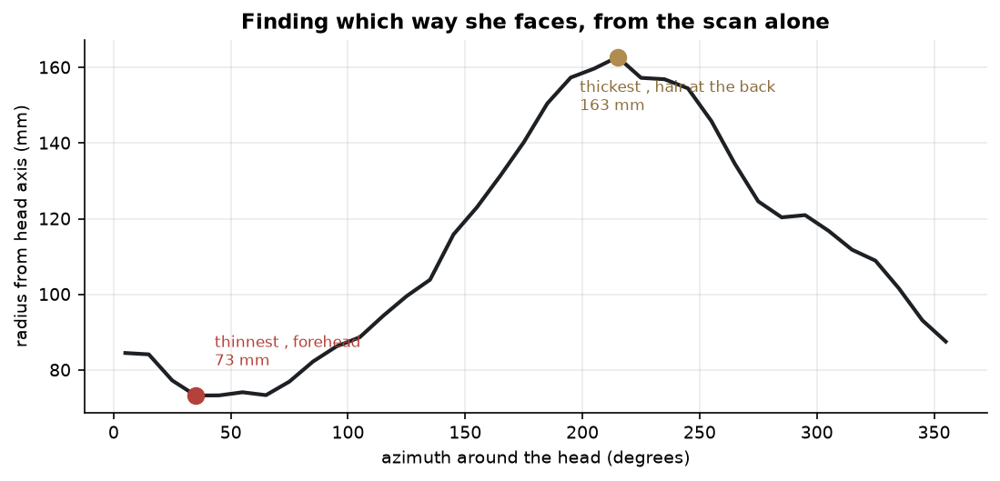 |
|:--:|:--:|
| Step 2: the mesh is in thousands of pieces until vertices are welded | Step 3: the shape heuristic that failed, and why |

| 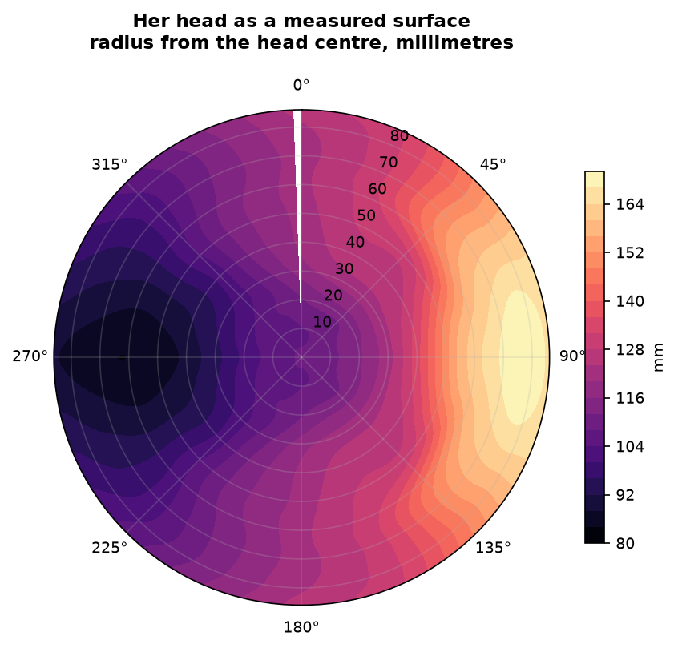 | 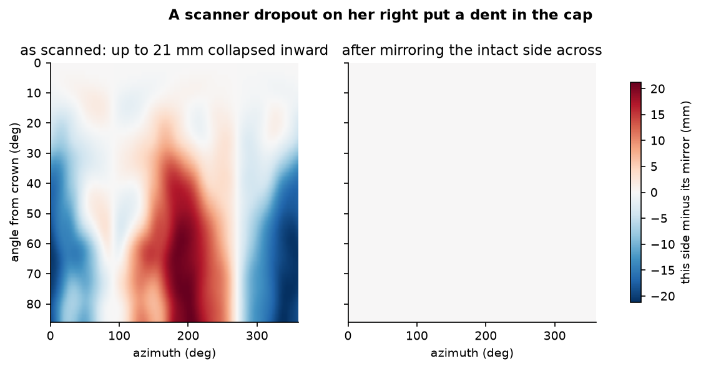 |
|:--:|:--:|
| Step 5: her head as a measured surface | Step 4: a scanner dropout, and its repair |

---

## Sizing: the one number nothing predicts

A LiDAR scan measures hair *where it lies*, uncompressed. This scan reads about
**800 mm** around the ring line against **575 mm** of tape on the scalp. That is
36 mm of loft everywhere, and a cap presses through it rather than resting on it.

How far hair compresses under a rigid band is the single number that decides fit,
and no measurement predicts it. So the answer is not to measure harder:

<div align="center">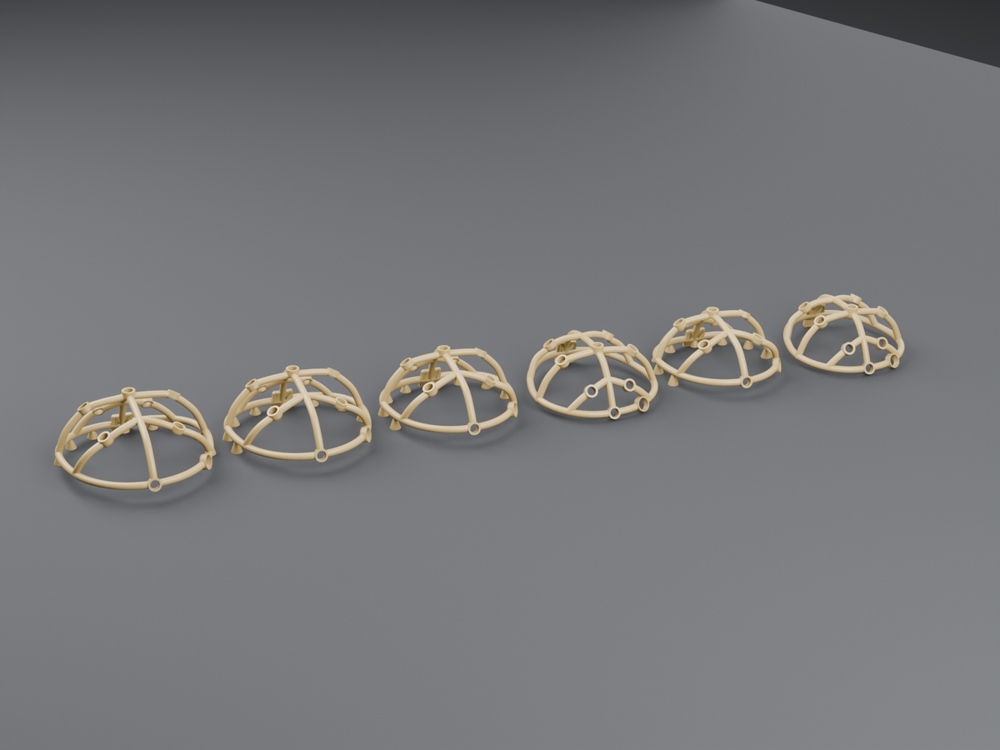</div>

| ring circumference | hair allowance | footprint | material |
|---|---|---|---|
| 620 mm | 7.2 mm | 214 × 222 mm | ~191 cm³ |
| **660 mm** | **13.5 mm** | **225 × 235 mm** | **~203 cm³** |
| **700 mm** | **19.9 mm** | **237 × 247 mm** | **~216 cm³** |
| 740 mm | 26.3 mm | 245 × 260 mm | ~228 cm³ |

Same head, four hair allowances. Print **660 and 700** first — they bracket the
likeliest fit. Each carries its circumference raised on the pod pad so they stay
tellable apart off the plate.

---

## Printing

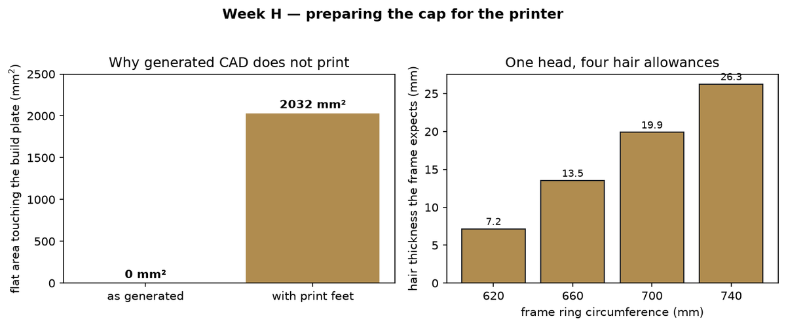

**The frame is a swept tube on a curved path, so nothing on it is flat.** Laid
ring-down it met the build plate at a single tangent point with **0.0 mm² of
first-layer area**. No brim can rescue that, because a brim needs something to
hold onto. This is the ordinary reason a generated model refuses to print.

Eight sacrificial feet now give it **2032 mm²** across well-spread pads, cut flat
against the same plane that trims the frame, with the part's centre of mass
inside them. Snip the necks, sand the stubs.

Settings for a Bambu H2D with a 0.4 mm nozzle are in
**[docs/PRINTING.md](docs/PRINTING.md)**. The three that matter:

> **Chamber off** — PETG strings and heat-creeps in a warm chamber.
> **Tree supports, build-plate-only** — otherwise they grow *inside* the dome.
> **Print as exported** — the feet are only flat in that orientation.

<div align="center">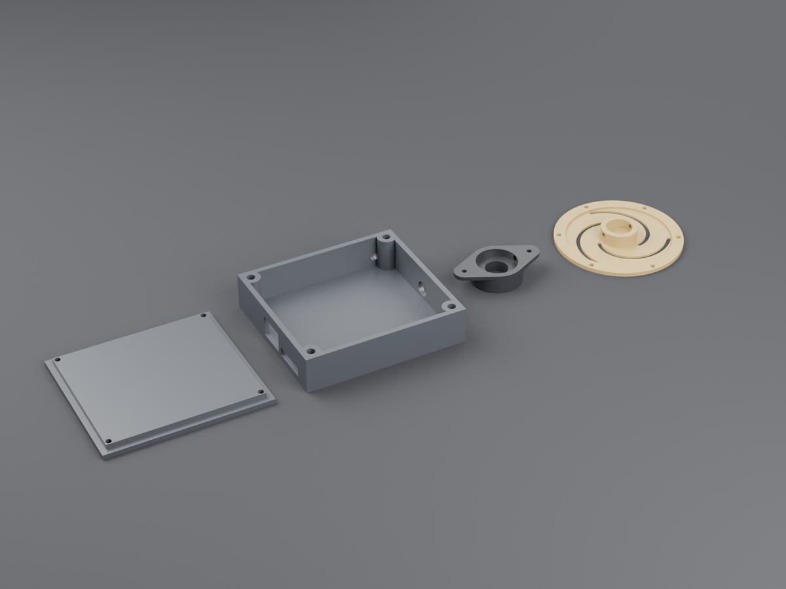</div>

---

## Things that looked right and were not

Every bug below rendered perfectly, exported cleanly, and was wrong. None was
visible by eye. All were caught by measuring the exported geometry and asserting
on a number, which is why `tests/` runs against the STL and not only the source.

| What happened | How it was caught |
|---|---|
| **The montage was on backwards.** Face detection assumed the thinnest side of a head is the forehead. Her hair lies flat at the occiput and full at the front, so it was 180° out and Fpz sat on the back of her head. | Skin colour in the scan texture: face reads RGB (155,107,87), hair (20,23,27) |
| **The hollowing did nothing.** Head STL exported at absolute scan coordinates, about 1.5 m up; the frame sat near the origin. The subtraction missed by a metre and a half and failed silently. | Facet count did not change when it should have halved |
| **A NaN OpenSCAD accepted.** At the crown the azimuthal derivative vanishes, so the surface normal was NaN. `rotate([0,nan,nan])` does not error, it makes garbage — at the one point where four bands meet. | Build now refuses to run on a NaN in generated parameters |
| **The frame came apart.** Band centrelines lay exactly on the surface they were cut against, so chord sag between samples let the subtraction bite. | Connectivity check: 2 components, not 1 |
| **Markers buried inside their own parts.** Three times: an index nub inside its boss, a size badge 2 mm inside the pad, lettering on the wrong side of a face. | STL-level test measuring axial reach |
| **A mislabeled STL.** A plausibility guard rejected one size, the build loop carried on, and wrote a frame labelled 736 containing the 690 geometry. | It would have been printed and tested as the wrong size |

The general lesson, written on the wall: **placing a feature exactly on a
boundary puts it on the wrong side of that boundary half the time.**

---

## Layout

```
fit/nsc_fit/          The geometry. No CAD, no hardware, all testable.
  head.py             Ellipsoid fitted to three tape measurements
  ten_twenty.py       International 10-20 positions
  scanned.py          LiDAR scan → aligned, repaired polar height field
  scad_export.py      Band paths and mounts, as OpenSCAD data
  template.py         Printable 1:1 marking template
  stlclean.py         Drops detached specks (and nothing else — see notes)
  build_scan.py       One command: scan in, verified STL out
cad/                  Parametric OpenSCAD
  params.scad         Every dimension and tolerance, including nozzle units
  cap_frame.scad      The frame, the head form, the fit coupon
  electrode_holder.scad   Sprung holder, flat printed spider spring
  sensor_puck.scad    PPG carrier with a light shroud
  electronics_pod.scad
render/               Headless Blender: stills, turntable, fit animation
tests/                Runs with no hardware; some render STLs and measure them
docs/                 PRINTING.md, DESIGN_NOTES.md, FITTING.md, PROTOCOLS.md
```

---

## Privacy

**Scans and generated head geometry are git-ignored.** A head scan is
identifiable biometric data about a named person, and this repository is public.
What lives here is the code that generates results, not the results.

The renders above use an untextured surface for the same reason.

---

<div align="center">
<sub>Built for the AAMED Neural Space Cap team, Purdue VIP.<br>
Design decisions and the reasoning behind them are in <a href="docs/DESIGN_NOTES.md">docs/DESIGN_NOTES.md</a>.</sub>
</div>
